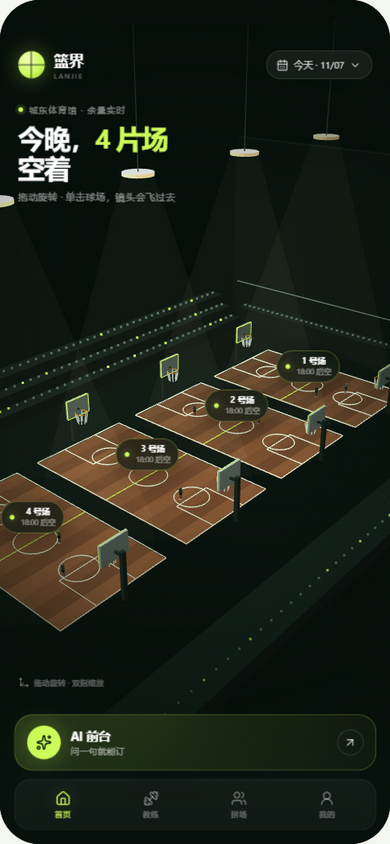
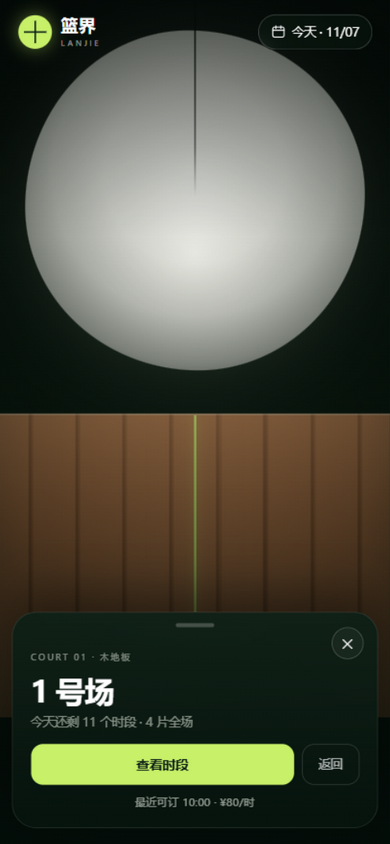
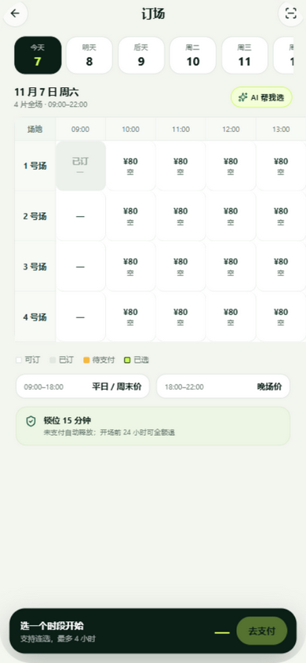
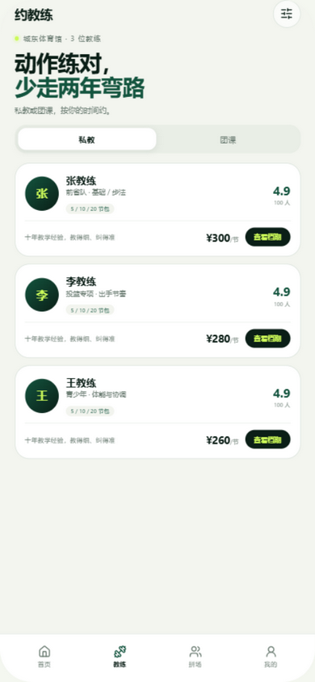
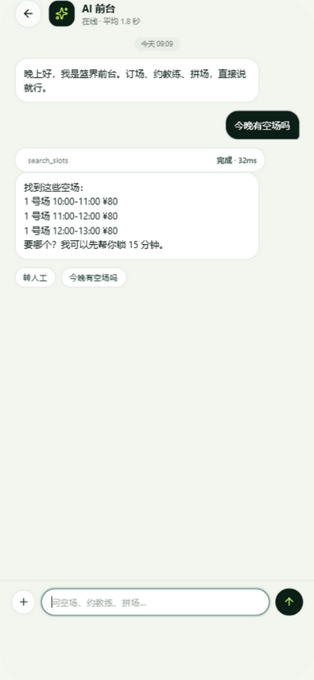
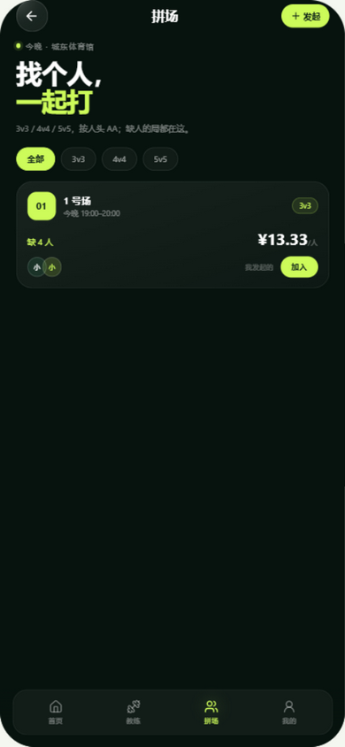
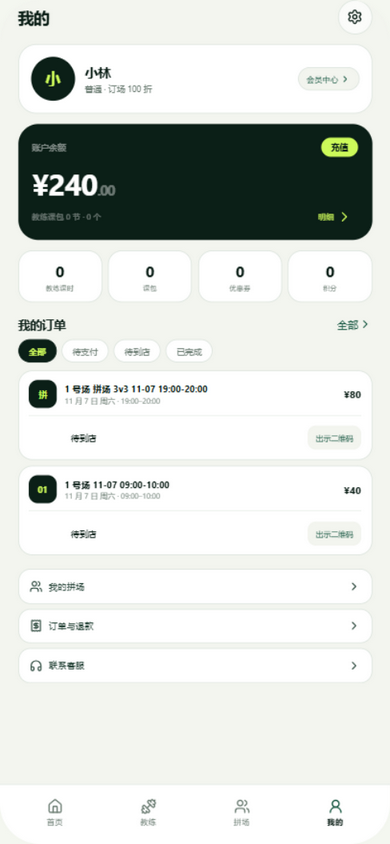
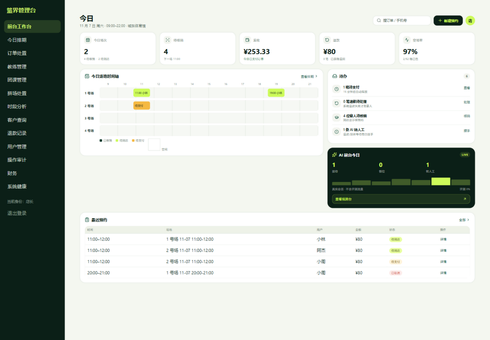

# 篮界 · 篮球馆预约系统


4 片全场篮球馆的 **订场 + 教练 + 团课 + 拼场 + 会员营销 + AI 前台** 全栈作品集。  
手机端优先，配 PC 前台工作台；业务规则、并发防超订、退款/改期、权限与 AI 工具调用均按真实场馆流程实现。



## 项目亮点

- **AI 前台**：mock / 智谱 GLM 双模型；12 个工具白名单；查空场、算价、锁位、转人工；锁位必须二次确认；40 条评测门禁，提示词注入拦截 100%。
- **3D 球馆首页**：四片场实时占用、球场标签、拖动旋转、点球场镜头飞入、时段卡直接锁位。
- **真实业务闭环**：15 分钟锁位、微信模拟支付/钱包支付、退款阶梯、改期多退少补、爽约封禁、一次性核销码。
- **教练与团课**：私教双资源锁、5/10/20 节课包、教练排班/请假、团课 4 人开班 8 人上限、候补自动递补。
- **拼场托管**：发起人付全场、份子钱平台托管、开赛结算；人数不足自动流局、发起人缺席、份子钱争议处置。
- **前台/店长分级**：前台可核销、排期、接待；退款、改价、财务、审计、发券、调余额收口到店长。
- **工程化**：84 个单元/集成测试（并发抢场、越权、E2E、AI 评测）、CI、Swagger、审计日志、CSV 导出。

## 界面

| 手机 · 首页 | 手机 · 球场详情 | 手机 · 订场 |
| --- | --- | --- |
|  |  |  |

| 手机 · 教练 | 手机 · AI 前台 | 手机 · 拼场 | 手机 · 我的 |
| --- | --- | --- | --- |
|  |  |  |  |



## 技术栈

- **后端**：Spring Boot 3.5、Java 17、MyBatis-Plus、MySQL 8、Redis、JWT、Spring Security、springdoc
- **前端**：Vue 3、Vite、TypeScript；手机端 `frontend-mobile`，PC 管理台 `frontend-pc`
- **视觉**：手写 WebGL 3D 球馆（无 Three.js / 无外部素材）；深色玻璃 + 荧光绿设计语言
- **AI**：OpenAI 兼容接口（智谱 GLM），默认 mock 可离线跑；工具白名单 + 确认凭证 + 评测门禁

## 核心业务规则

- **订场**：4 片全场，09:00–22:00，1 小时一格，同场连续最多 4 格；日限 2 单。
- **锁位**：Redis 快速失败 + 数据库条件更新双重兜底，15 分钟未支付自动释放。
- **退款**：开场前 ≥24h 全退，2–24h 退 70%，<2h 不退；全退返还优惠券与积分。
- **改期**：开场前 2h、每单限 1 次；差价多退少补。
- **爽约**：7 天内 3 次，禁订 7 天。
- **会员**：0/1000/3000/8000 四档，98/95/92 折；充值赠送；折扣与券二选一，积分最多抵 20%。
- **团课**：4 人开班、上限 8 人；满员候补；取消整班全员全退、候补一并取消。
- **拼场**：3v3/4v4/5v5；发起人付全场；份子钱托管，开赛 1 小时后结算；开赛前 2 小时未满员自动流局全退。

## 质量与测试

```bash
cd backend && mvn test
```

- **84/84 测试通过**：订场锁位、支付幂等、退款阶梯、改期、爽约、教练课包、团课候补、拼场结算/异常、AI 评测、越权隔离、6 线程并发抢场。
- 手机端 / PC 端均通过 `vue-tsc` 与生产构建。
- 交付库内置演示数据，不含自动化测试记录。

## 快速开始

依赖：MySQL 8（3306）、Redis（6379），也可 `docker compose up -d`（默认 root/root，自动导入表结构）。

```bash
# 1. 建库 + 表结构
mysql -uroot -p -e "CREATE DATABASE IF NOT EXISTS lanjie DEFAULT CHARSET utf8mb4"
mysql -uroot -p lanjie < sql/schema.sql

# 2. 本机数据库配置
cp backend/src/main/resources/application-dev.example.yml \
   backend/src/main/resources/application-dev.yml
# 编辑 application-dev.yml 填本机密码；该文件已被 gitignore

# 3. 后端 8082
cd backend && mvn spring-boot:run

# 4. 手机端 5179
cd frontend-mobile && npm install && npm run dev

# 5. PC 管理台 5180
cd frontend-pc && npm install && npm run dev
```

演示环境短信验证码固定 `123456`。

| 角色 | 账号 | 密码 |
| --- | --- | --- |
| 店长 | `13800000000` | `admin123` |
| 前台值班 | `13800000001` | `front123` |
| 教练 | `13900000001` / `13900000002` / `13900000003` | `coach123` |
| 顾客 | `13800001001` / `13800001002` / `13800001003` | `123456` |

AI 默认 mock（离线可跑）；接真模型：

```bash
AI_PROVIDER=glm GLM_API_KEY=你的key mvn spring-boot:run
```

## 目录

```
backend/                 Spring Boot API（订场/支付/退款/教练/团课/拼场/会员/AI/管理端）
frontend-mobile/         手机端（Vue3 + Vite，3D 球馆、订场、教练、AI、拼场、我的）
frontend-pc/             PC 前台工作台（今日看板、排期、订单、教练/团课、财务、审计）
frontend-mobile/public/demo/  视觉原型（mock 数据，供设计对照）
sql/schema.sql           45 张业务表
docs/product-brief.md    产品说明与冻结基线
docs/api.md              接口清单
```

## 说明

- 金额统一整数分（`*_cents`）；时间存本地 Asia/Shanghai。
- Swagger：`http://localhost:8082/swagger-ui.html`
- 演示数据为虚构顾客与场馆，不含真实个人信息。
